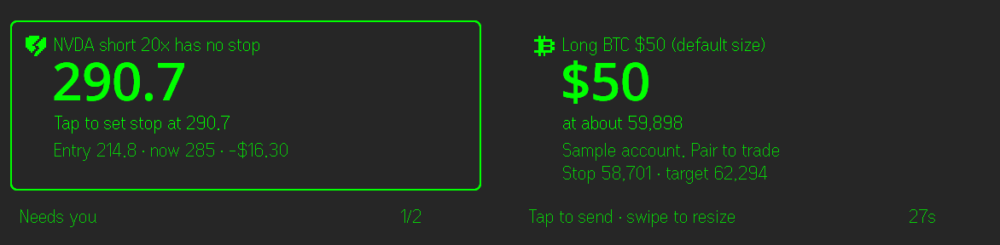
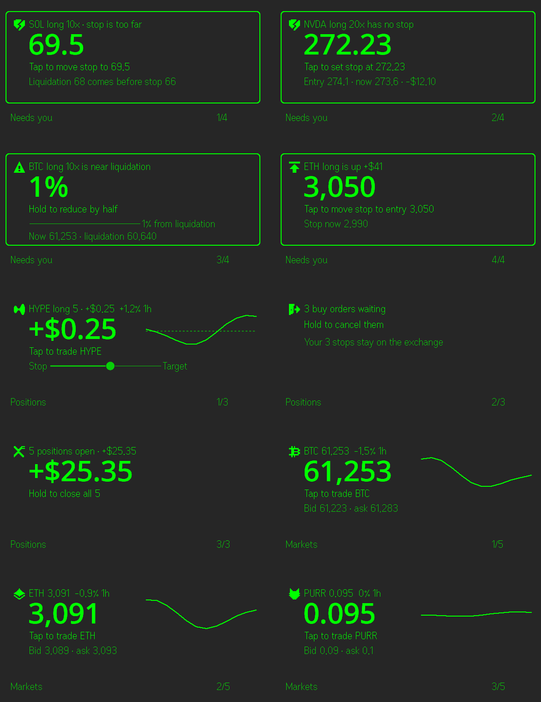

# Lookout

Lookout shows the one Hyperliquid position that needs you on your Even G2 glasses, with the fix already loaded: tap to set the stop, hold to close.



*Real Hyperliquid testnet data, shown in the Even Hub simulator in read-only sample mode.*

| | |
|---|---|
| Track | 02 · Crypto & DeFi (Hyperliquid testnet) |
| Hosted app | https://lookout.timidan.xyz |
| Demo video | to come |
| Try it | `evenhub-simulator https://lookout.timidan.xyz`, or run it locally below |

## What it does

Most trading apps put a dashboard in front of you. On glasses you get a few words, so Lookout ranks what needs you and shows one card at a time:

| Card | What you see | One action |
|---|---|---|
| Liquidation before stop | `SOL long 10x · stop is too far` | Tap to move the stop inside liquidation |
| No stop | `NVDA short 20x has no stop` | Tap to set a stop |
| Near liquidation | `BTC long 10x is near liquidation` | Hold to reduce by half |
| In profit | `ETH long is up +$41` | Tap to move the stop to entry |
| Waiting orders | `3 buy orders waiting` | Hold to cancel them; your stops stay |
| Open positions | `5 positions open · +$35.10` | Hold to close all |
| Markets | Live price, a line of the last 90 seconds that moves with each tick, the hour's change, bid and ask | Tap to trade |

Each card's key number is drawn about three times larger than the text: the stop price a tap will set, the distance to liquidation, the dollar size of a ticket, a market's live price, a position's profit or loss. It is always a copy of a number already in the card's text, and a tap confirms the text.

**Sizing without talking numbers.** A new order uses your usual size, the median of your last ten entries on that market. Swipe to change it. Every new perp long or short carries a stop and a target by default. Say "Long BTC" and you get a priced ticket; if a spoken number is ambiguous, the glasses ask "15 or 50?".

**Small actions are a tap. Big ones are a two-second hold** with a bar that fills, so a brushed temple never closes a position.

**The glasses' own menu** jumps to Needs you, Positions, Markets, Close all positions or Cancel waiting orders. Each entry only opens the card; the card's tap or hold still sends.



*Every card kind, drawn with the stand-in backend (`app/mock.ts`), since the sample account doesn't hit them all at once.*

## Controls

| Gesture | Does |
|---|---|
| Tap | Take the action shown, or send a priced order |
| Hold | Confirm a big action (2 s). Elsewhere, hold to speak and release to send |
| Double tap | Back. From home, the exit prompt |
| Swipe | Next card or choice, or change a ticket's size |

## How it works

```
G2 glasses ──BLE── Even app WebView (app/) ──HTTPS── backend (server/) ──── Hyperliquid testnet
  display, touch,      Even Hub SDK: containers,       pairing, tickets, cards,     info API, websocket,
  ring, microphone     input, audio, menu              signing with an agent key    exchange API
```

1. **Pairing.** The glasses show a six-letter code and a link. On the phone, the owner's wallet signs one `approveAgent` message for Hyperliquid **testnet**, valid for seven days. The backend holds that agent key encrypted (AES-256-GCM). An agent key can trade but cannot withdraw.
2. **Cards.** The backend reads positions, orders and stops, ranks the problems, and streams the card stack to the glasses over server-sent events.
3. **Tickets.** A tap or a voice command gets a priced ticket that lasts 30 seconds. Confirming sends it once, with a client order ID, so a retry after a timeout looks the order up instead of sending it again.
4. **Voice.** The glasses stream microphone audio; the backend sends it to any OpenAI-compatible speech-to-text endpoint and parses short commands such as "Long BTC" or "Close half SOL" into a priced ticket.

Before pairing, the app opens on a read-only sample account with live testnet data, so you can see the cards without a wallet.

## Safety

- Testnet only. The approval names `hyperliquidChain: Testnet`, so it cannot authorise a mainnet agent.
- No keys in the glasses app. The device holds a random session token; the agent key never leaves the backend.
- New orders are capped (`MAX_ORDER_USD`, $200 by default). Closing orders are not capped.
- Every new perp long or short gets a stop. Cancelling waiting orders keeps stops in place.
- Per-address request limits on pairing, voice and the API.
- No financial advice: Lookout shows your own positions and acts only when you tap or hold.

## Evidence and limits

| Claim | Status |
|---|---|
| Orders are signed correctly for perps, spot, outcome markets, stops, entries with stop and target, trailing stops and cancels | Checked against testnet with `npm run sign-check` in `server/`: the exchange recovered the expected signer for all nine. Each was then refused for lack of funds |
| Cards, graphs and tickets on real testnet data | Seen in the simulator against the real backend, using the sample account (read-only) |
| A filled order, a placed stop, close all | **Not yet shown.** No funded testnet wallet yet |
| Voice | Works end to end with a speech-to-text endpoint. The hosted app has none set up yet |
| Launch from the glasses menu, other people's speech dropped | Written against the SDK; the simulator doesn't send either, so untested |

## Run it yourself

Needs Node 22.13 or later (22.x) and the Even Hub simulator (`npm install -g @evenrealities/evenhub-simulator`).

```bash
cd server
cp .env.example .env    # set APP_SECRET; SAMPLE_ADDRESS is optional
npm install
npm start               # http://localhost:8790
```

```bash
cd app
npm install
npm run dev             # http://localhost:5173, talks to the backend on 8790
evenhub-simulator http://localhost:5173
```

Without a backend, `npm run mock` in `app/` starts the stand-in on port 8788 (pairing code `SX3XG9`); run the app with `VITE_API_BASE=http://localhost:8788`.

Tests: `npm test` in `server/` and in `app/`.

To host it in one container: `docker build --build-arg VITE_API_BASE=https://your.host -t lookout .`, then run it with the same variables as `server/.env.example`.

## What existed before 23 November

Nothing in this repository existed before 23 November 2026. It uses these open-source libraries: the Even Hub SDK, `@nktkas/hyperliquid`, viem, Hono, Vite, TypeScript and tsx. The large digits are drawn from Noto Sans Medium (SIL Open Font License), baked into `app/digits.ts` by `app/scripts/digits.py`.
